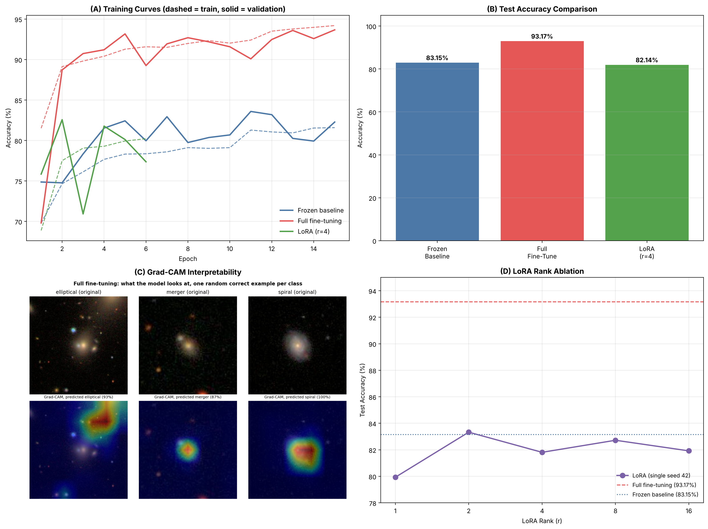

# Finetuning DL Models on Astrophysical Datasets

TMI-102 project (PaAC, IIT Roorkee) by Gurpreet Singh. Compares three ways of adapting an ImageNet-pretrained **ResNet-50** to classify galaxies from **Galaxy Zoo** into three classes: **elliptical, merger, spiral**.

**Live web demo:** https://neogurpreet-dev.github.io/tmi102-finetuning-dl-models/

## Results (test set, 2,766 images)

| Metric | Frozen baseline | Full fine-tuning | LoRA (r=4, head) |
|:---|:---:|:---:|:---:|
| Trainable parameters | 525,315 | 24,059,907 | 9,987 |
| Test accuracy | 83.15% | **93.17%** | 82.14% |
| Test loss | 0.4605 | 0.2037 | 0.4694 |
| Macro-F1 | 0.737 | 0.892 | 0.716 |
| Merger recall | 43.25% | **80.98%** | 37.42% |

Main finding: updating the backbone mattered far more than adapter size. A LoRA rank ablation (ranks 1, 2, 4, 8, 16; single seed 42) showed no trend, 79.93% to 83.33%, so rank was not the bottleneck. Mergers are the hard class for every method.

## Data

Galaxy Zoo images, 3 classes. Elliptical and spiral: 5,692 / 1,220 / 1,220 images (train / val / test). Merger: 1,520 / 326 / 326. Mergers are about 3x rarer, so class weights were used. Labels are cutoffs on volunteer vote fractions. The dataset is not included in this repo.

## Method

- **Frozen:** ResNet-50 backbone frozen, trained head only.
- **Full fine-tuning:** all layers trained.
- **LoRA:** low-rank adapter (rank 4, alpha 32) on the 256-unit head; the backbone stays frozen.
- Class weights, early stopping (patience 4, best epoch restored), Grad-CAM for interpretability.

## Repo layout

| Path | Contents |
|:---|:---|
| `index.html` | Web demo (GitHub Pages): project journey, results, key finding |
| `notebooks/Week_11_Final_Report.ipynb` | Final report: abstract, figure, results table, discussion |
| `notebooks/Retrain_3class_Models_Kaggle.ipynb` | Retraining the three models (Kaggle) |
| `notebooks/Week_8_*`, `Week_9_*` | Robustness and advanced metrics |
| `notebooks/Week11_*` | Grad-CAM and LoRA rank ablation (Kaggle) |
| `results/` | `results_3class.json`, `histories_3class.json` |
| `figures/` | Summary figure and per-class Grad-CAM |
| `scripts/build_dataset_3class.py` | Builds the 3-class dataset |

Model weights (`.keras`, 100 to 290 MB each) are not stored here because of GitHub size limits.

## Limitations

LoRA was applied to the head only; ranks were run with one seed; merger labels are noisy; LoRA's early stopping picked epoch 2, which may be luck. See the final report notebook.
